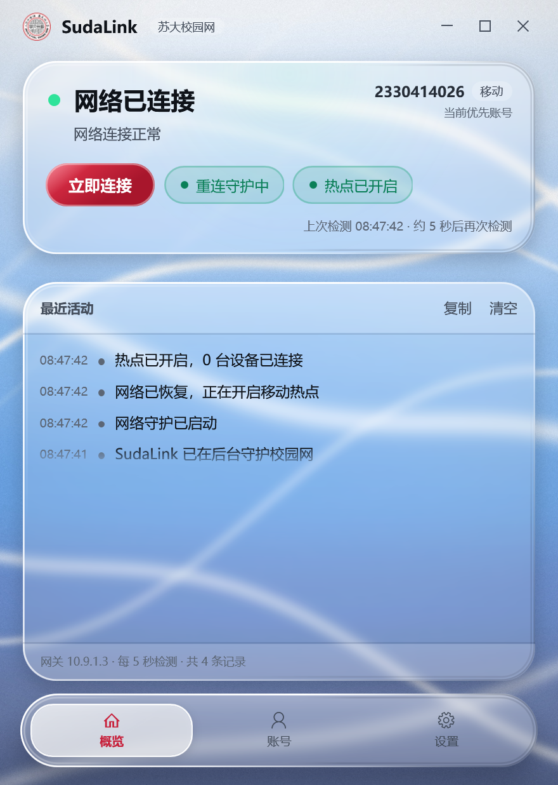
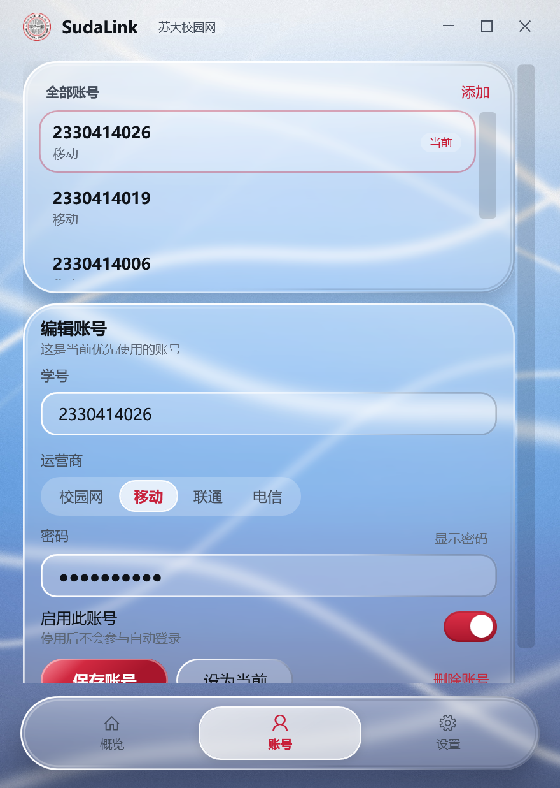
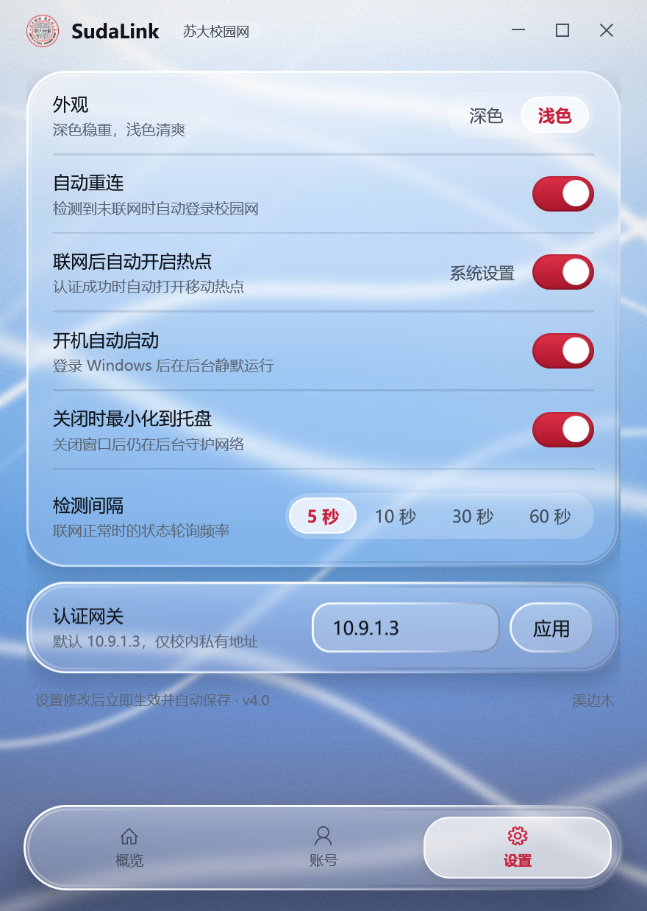
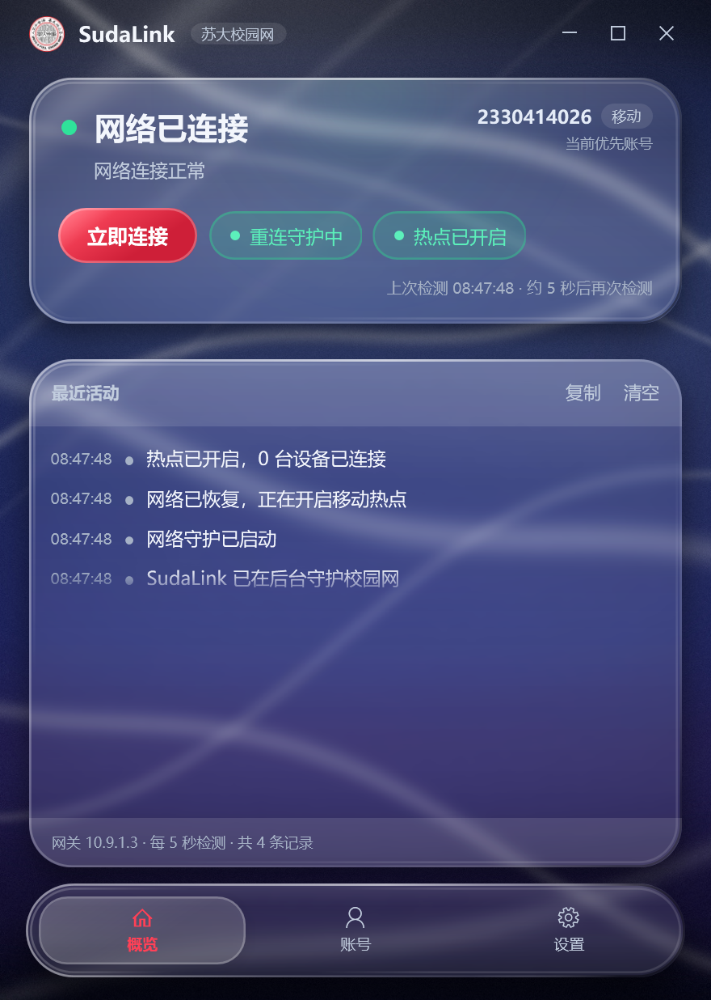
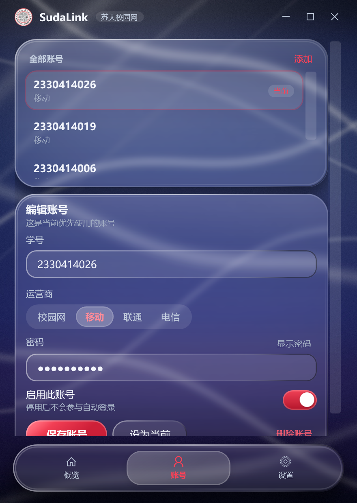
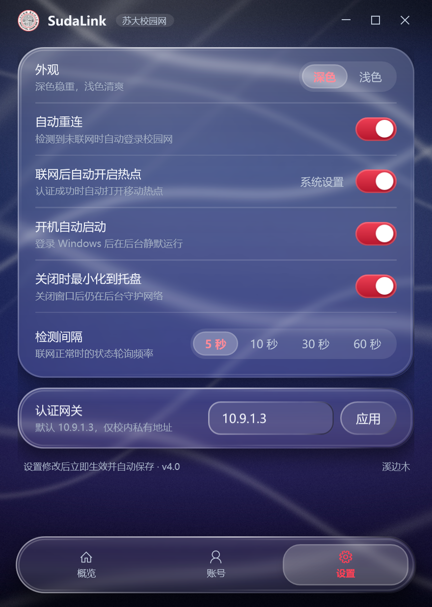

# SudaLink · 苏大校园网自动登录助手

> 给苏州大学校园网（Dr.COM / eportal 网关）用的自动登录小工具。
> 一个 78 MB 的自包含单文件 exe，双击即可用；界面是手写的「液态玻璃」材质。

作者：**溪边木**



---

## 它做什么

- **自动登录**：每 5～60 秒探测一次，掉线自动重新认证，不用再开浏览器点登录页。
- **多账号**：可存多个学号，任意选择运营商（校园网 / 移动 / 联通 / 电信），当前账号优先、其余轮试。
- **移动热点联动**：认证成功后可以自动把 Windows 移动热点打开；面板上的热点胶囊可以直接开关。
- **托盘常驻**：关闭窗口后可缩到托盘继续守护，支持开机自启与后台静默启动。
- **密码安全**：密码用 Windows DPAPI（当前用户作用域）加密存放，文件被拷走也无法解出明文。

| 账号 | 设置 |
| --- | --- |
|  |  |

深色模式：

| 概览 | 账号 | 设置 |
| --- | --- | --- |
|  |  |  |

---

## 快速开始

1. 到 [Releases](../../releases) 下载 `SudaLink.exe`（Windows 10 1809+ / Windows 11，x64）。
2. 双击运行，进入「账号」页填写学号、选择运营商、输入密码，点「保存账号」。
3. 回「概览」页点「立即连接」验证一次；此后它会在后台自己守着。

不需要安装 .NET 运行时（已自包含）。配置文件 `sudalink.json` 生成在 exe 同目录。

---

## 界面是怎么做的

WPF 没有系统级模糊可用（这台机器上 `SetWindowCompositionAttribute` 与
`DWMWA_SYSTEMBACKDROP_TYPE` 都返回成功但不生效），所以玻璃是**自绘**的，
核心是 `src/SudaLink/Controls/GlassPanel.cs`：

1. 窗口底层是一张自己生成的壁纸 `Image`（`tools/gen_wallpaper.py`，numpy + PIL）。
2. 每块玻璃按自己在窗口里的位置，把壁纸矩形**解析式地**换算成壁纸像素坐标
   （`UniformToFill` 的缩放与居中偏移都算进去），得到一个 `ImageBrush(Viewbox=…)`。
3. 这个 brush 贴上 `BlurEffect`，就是「透过玻璃看到的、被磨掉细节的背景」；
   采样区外扩 `Bleed` 抵消模糊吃边，再用圆角 `Clip` 裁掉。
4. 上面再叠：极薄的染色层、顶部受光渐变、内侧第二道高光（做出厚度）、
   跟随指针的镜面高光、1px 外缘描边。

几条踩出来的规律，写在代码注释里也写在版本记录里：

- **模糊要有东西可模糊**。背景若是一整片相近的淡色，模糊前后毫无差别，玻璃就成了塑料。
  所以壁纸必须有**锐利的无彩白丝**和明显的明暗跨度。
- **模糊会把互补色平均成灰**。一屏从蓝跨到玫红，玻璃里必然是脏灰——这是"脏"的物理来源，
  不是调透明度能救的。
- **玻璃该提亮不该压暗**。白色染色层超过 20% 就开始发奶白，低于 10% 又会在深色背景上丢字。

---

## 从源码构建

需要 .NET 8 SDK（Windows）。

```bash
git clone <this-repo>
cd SudaLink
dotnet build src/SudaLink/SudaLink.csproj -c Release
dotnet run --project src/SudaLink/SudaLink.csproj
```

发布成单文件：

```bash
dotnet publish src/SudaLink/SudaLink.csproj -c Release -o dist
# dist/SudaLink.exe
```

跑单元测试：

```bash
dotnet run --project tests/SudaLink.Tests/SudaLink.Tests.csproj
```

重新生成壁纸（改了配色想自己调时）：

```bash
pip install numpy pillow
python tools/gen_wallpaper.py src/SudaLink/Assets
```

### 开发用启动参数

| 参数 | 作用 |
| --- | --- |
| `--background` | 启动即缩到托盘，不弹窗（开机自启用） |
| `--page=overview\|accounts\|settings` | 直接打开指定页 |
| `--theme=light\|dark` | 临时覆盖主题，不写回配置（截图用） |
| `--render=<目录>` | 把三个页面渲染成 PNG 后退出（文档截图用） |
| `--render-wait=<秒>` | 配合 `--render`：先跑一段时间再截图，用来观察真实运行后的日志 |

---

## 目录结构

```
src/SudaLink/
  Core/                 # 纯逻辑，可被测试工程直接引用
    PortalAuthenticator.cs   Dr.COM eportal 协议：判断在线 / 提交登录 / 解析错误码
    NetworkMonitor.cs        轮询、退避、暂停、状态机
    ConfigStore.cs           配置读写、DPAPI 加密、旧配置迁移
    SystemServices.cs        开机自启、WinRT 移动热点
    Models.cs
  Controls/
    GlassPanel.cs            液态玻璃面板（取样 / 模糊 / 描边 / 镜面）
    CornerRadiusInsetConverter.cs
  Themes/                # Palette.Light.xaml / Palette.Dark.xaml，全部颜色走 DynamicResource
  Theme.xaml             # 控件样式与 GlassPanel 模板
  ThemeService.cs        # 运行时替换色板
  WindowFx.cs            # DWM 圆角、阴影、标题栏行为
  MainWindow.xaml(.cs)   # 三个页面
tests/SudaLink.Tests/    # 6 个针对协议的单元测试
tools/gen_wallpaper.py   # 生成 Assets/backdrop-*.jpg
docs/versions/           # 每个版本做了什么、为什么、踩了什么坑
```

---

## 协议备忘

```
GET  http://10.9.1.3/?isReback=1                 判断在线（uid='0' 表示未登录）
POST http://10.9.1.3:801/eportal/?c=ACSetting&a=Login
      表单：DDDDD=<学号><运营商后缀>&upass=<密码>&R1=0&R2=0&R6=0&para=00&0MKKey=
      成功：响应含 Dr.COMWebLoginID_3
      失败：Msg=01..09（见 PortalAuthenticator 里的错误码映射）
运营商后缀：校园网 / 移动 @zgyd / 联通 @cucc / 电信 @ctc
```

**注意返回 302 是正常的。** 认证被受理后网关会跳到结果页：

```
302 → /2.htm?...&RetCode=2&ErrorMsg=Mg%3D%3D   # base64("2")，通常表示本机已在线
```

`RetCode` 不是"失败码"，302 也不是错误 —— 这类响应的正文往往是空的，
所以判定成败必须靠"到底能不能上网"，而不是看 HTTP 状态码。
（4.1.0 就是踩了这个坑，详见 [docs/versions/v4.1.md](docs/versions/v4.1.md)。）

---

## 版本记录

从 2.0 重写到 4.1，一共 10 个版本，每一次的动机、实现和踩坑都在
[`docs/versions/`](docs/versions/) 里，索引见 [CHANGELOG.md](CHANGELOG.md)。

---

## 免责声明

- 本项目仅用于**自己**的设备自动登录校园网，减轻重复操作；请遵守学校网络使用规定。
- 不收集、不上传任何数据；所有凭据只存在本机的 `sudalink.json` 中，且经过 DPAPI 加密。
- 与苏州大学官方无关。协议来自对公开登录页的观察，学校若调整网关，工具可能失效。
- 使用本工具产生的一切后果由使用者自行承担。

## License

[MIT](LICENSE) © 溪边木
